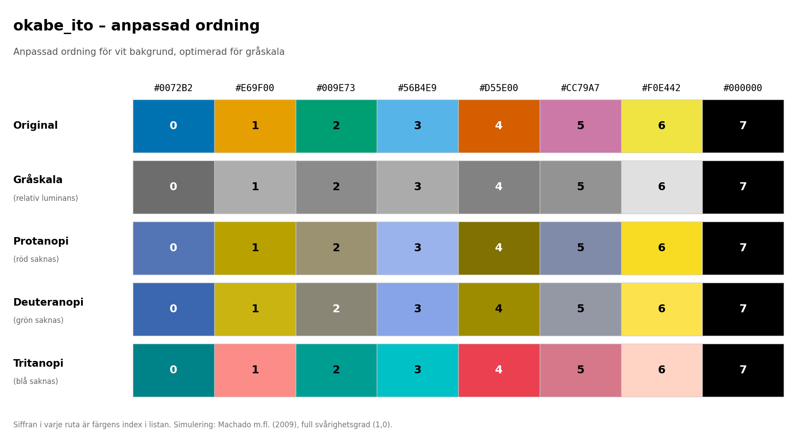
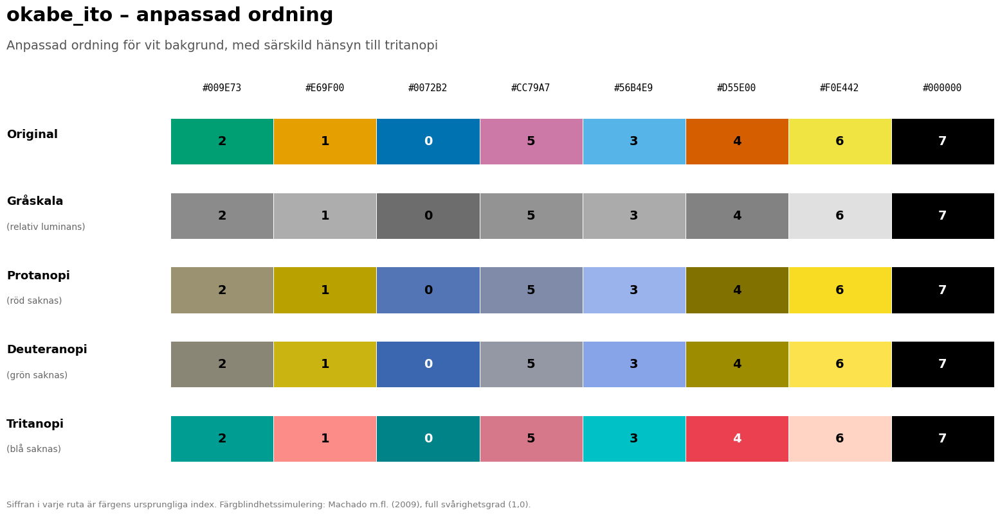
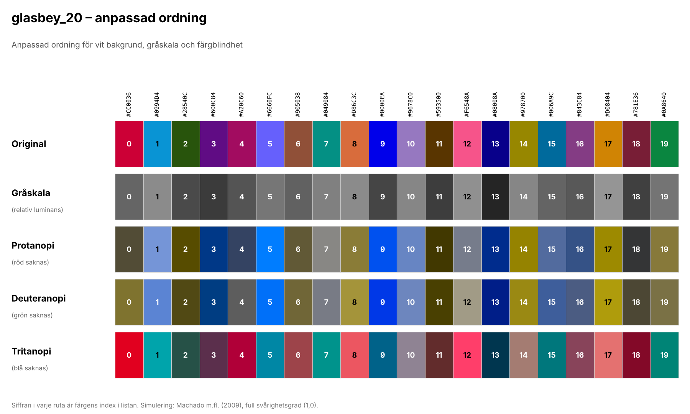

# Visualization Principles and Color Palette Guidelines

**Author:** Håkan Fridlund

## Introduction

The visualizations in this project are designed with **scientific publishing**, good data visualization practices, and **accessibility** in mind. The aim is to create **clear**, interpretable, and broadly usable figures that communicate statistical information accurately and consistently.

The color palette is based primarily on the **colorblind-friendly** Okabe–Ito palette, developed to improve color distinguishability and reduce the risk of misinterpretation for people with different types of **color vision deficiencies**.

The original order of the Okabe–Ito palette has been modified to improve the separation between consecutive colors, particularly in grayscale reproduction. The colors should be used in the specified order to preserve these optimizations.

## Okabe-Ito Customized Palette

Alternative okabe_ito_tritanopi palette with customized order optimized for tritanopi.

## General Considerations

The following principles guide the design of all visualizations:

* **Color vision accessibility:** Colors are selected to improve distinguishability, including for people with **color vision deficiencies**.
* **Black-and-white printing:** The color order is optimized for grayscale reproduction, particularly for the Okabe–Ito palette, to **improve readability** when color information is unavailable.
* **Contrast and readability:** Color combinations, clear axes, and consistent typography are used to improve legibility.
* **Consistent design:** A shared visual standard makes it easier to compare figures within and across reports.
* **Scientific integrity:** Visualizations should communicate statistical results clearly and objectively, without distorting or exaggerating the underlying data.
* **Broad usability:** The palettes and design principles are intended to work across different display environments, print formats, and individual viewing conditions.

Together, these principles support **inclusive** communication and improve **access** to the information presented.

### Limitations – Okabe–Ito

Although the Okabe–Ito palette provides a strong foundation for **accessible** categorical visualizations, some colors have practical limitations:

* **Color 7 – Yellow (#F0E442):** Has relatively low contrast against a white background (approximately 1.32:1), which may reduce visibility in certain chart types, particularly when used for thin lines or small markers.
* **Color 8 – Black (#000000):** May be less suitable in some visualizations, such as bar charts, where it can visually merge with axes, borders, and other black graphical elements.

Depending on the chart type and intended use, the practical number of distinguishable colors in the Okabe–Ito palette may therefore vary between six and eight. In some cases, the Glasbey palette may be more suitable even when fewer categories are displayed.

## Color Palette for Larger Numbers of Categories

When the Okabe–Ito palette does not provide sufficient contrast or color separation for a particular visualization, an alternative 20-color palette based on the Glasbey method can be used.

The Glasbey palette is not intended to automatically replace Okabe–Ito at a fixed number of categories. The choice between the palettes should depend on the chart type, visibility against the background, and the need for clear distinction between categories.

## Glasbey_20 Palette

### How the Glasbey Palette Was Developed

The 20-color palette was developed using an algorithmic selection process based on the Glasbey method, starting from a large pool of sRGB colors. Individual color pairs that still appeared too similar during visual inspection were manually adjusted.

The following priorities were used:

* **Contrast against white:** All colors were selected to achieve a minimum contrast ratio of 3:1 against a white background. This provides a useful **accessibility** benchmark for graphical elements. Actual compliance depends on how the colors are used in the figure. The approach is informed by WCAG 2.1, Success Criterion 1.4.11 (Non-text Contrast).
* **Color separation – normal vision:** CIEDE2000 was used to evaluate perceptual color differences and maximize the minimum separation between colors. Color pairs that still appeared too similar during visual inspection were replaced.
* **Color separation – color vision deficiencies:** The same perceptual difference metric was applied to simulated protanopia, deuteranopia, and tritanopia. The simulations were based on the model described by Machado et al. (2009). The worst-performing result among the three simulations was given greater weight than the result for normal color vision.
* **Grayscale:** Differences in lightness (ΔL*) were considered, but given lower priority than color separation. With 20 colors, it is not realistic to achieve clear lightness separation between every color in grayscale.
* **Color order:** The order was optimized to improve separation between neighboring colors, taking into account color difference, simulated **color vision deficiencies**, and lightness. Colors separated by one position were given the highest priority, followed by colors separated by two and three positions. The list was treated as circular, meaning that the last and first colors were also considered neighbors.

### Limitations

The following limitations should be considered when using the Glasbey palette:

* **Simulated color vision deficiencies:** The palette has been evaluated using simulations rather than tested with people who have actual **color vision deficiencies**. The simulations represent full-severity cases and should be regarded as a technical assessment, not a substitute for user testing.
* **Grayscale reproduction:** All 20 colors cannot be reliably distinguished in grayscale. Some color pairs have very similar lightness values.
* **Large numbers of categories:** When using more than approximately eight series, color alone should not be relied upon to distinguish categories, even when the figure is displayed in color.

For black-and-white printing, and whenever color separation is insufficient, additional visual identifiers such as line styles, markers, patterns, direct labels, or text identifiers should be used.

# Usage Guidelines

* **Color order:** Colors must be used in the specified list order, from top to bottom, to preserve the optimizations made for color separation, **color vision deficiencies**, and grayscale reproduction.
* **Multiple visual identifiers:** When more than eight series are displayed, color should not be the only means of distinguishing categories. Supplementary identifiers such as markers, line styles, patterns, direct labels, or text identifiers should be used where appropriate.
* **Consistent palette selection:** If the Glasbey 20 palette is used in one chart within a report, the same palette should be used consistently in all other charts in that report. The same variable or category should retain the same color across all visualizations. This establishes a consistent visual standard and makes comparisons and recognition easier.
* **Background considerations:** Color visibility should always be assessed against the chart background. Colors that work well on white backgrounds may not be equally suitable on darker or colored backgrounds.
* **Categorical data:** These palettes are intended for categorical data. Sequential or diverging color scales should be used for continuous variables, depending on the type of data and the information being communicated.

## References

* Okabe, M., & Ito, K. (2008). *Color Universal Design (CUD): How to Make Figures and Presentations That Are Friendly to Colorblind People*. Original work published in 2002.  
  https://jfly.uni-koeln.de/color/
* World Wide Web Consortium (W3C). *Web Content Accessibility Guidelines (WCAG) 2.1 – Success Criterion 1.4.11: Non-text Contrast*.  
  https://www.w3.org/TR/WCAG21/#non-text-contrast
